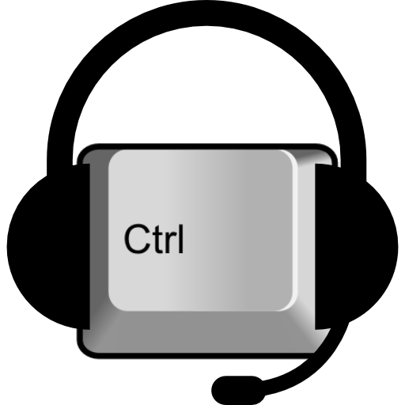

# Shortcut Reminder

 
   

A simple tool that reminds you of available keyboard shortcuts whenever you need them, helping you discover and use them without interrupting your workflow.

Works with applications that support the [Assistive Technology Service Provider Interface (AT-SPI)](https://www.freedesktop.org/wiki/Accessibility/AT-SPI2/), the primary accessibility infrastructure for free and open-source desktops.
## Roadmap

- Support all system shortcuts
- Create a polished, intuitive UI

## Support

If you’re having trouble with Shortcut Reminder, please open a ticket and include all the necessary information.

You can also contact me on Matrix at @78dh:matrix.org.

## Contributing

Contributions are always welcome!

See `contributing.md` for ways to get started.

Please adhere to this project's `code of conduct`.

## License

[MIT](https://choosealicense.com/licenses/mit/)

## Demo

https://www.youtube.com/watch?v=vn0VPiDfoeE
